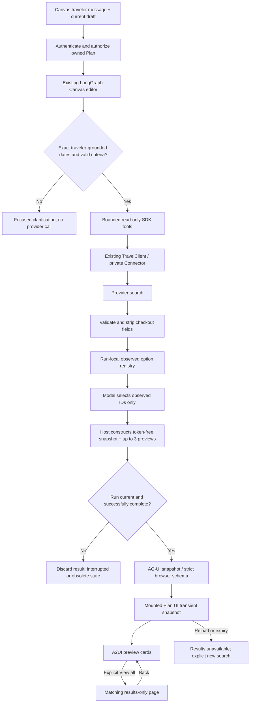

# Phase 16: Date-gated travel previews and booking navigation — Research

**Researched:** 2026-10-16
**Domain:** Canvas-only agent tools, exact-date authorization, transient provider results, A2UI
**Confidence:** MEDIUM overall; code findings directly read, SDK documentation cross-checked with official sources.

<user_constraints>
## User Constraints (from CONTEXT.md)

<!-- DATA_b4f18a72_START -->
### Locked Decisions
- **D-01:** Only Planning Canvas chat gets these tools; initial trip chat remains unchanged.
- **D-02:** Reuse existing A2UI styling; user declined three alternative prototypes by agreeing with the recommendation. Still produce and inspect a preimplementation visual sketch and implementation screenshots.
- **D-03:** Show up to three observed options per search in chat; a View all flights/stays button opens the dedicated page with the matching results.
- **D-04:** New navigation opens a results-only page; booking functionality and a separate booking LangGraph flow are deferred. Preserve existing unrelated sandbox checkout behavior.
- **D-05:** Exact departure/return or check-in/check-out dates are required before provider searches. Ask a focused question for missing/ambiguous dates; never invent dates or year. Prefer explicit current canvas dates; dates supplied for a search do not silently mutate durable Plan data.
- **D-06:** Expose read-only search capabilities through the existing authenticated/private travel integration and a bounded agent skill, following the current activity-tool pattern.
- **D-07:** Full GSD flow is authorized: research, UI and AI contracts, checked execution plans, implementation, review and verification. Routine implementation and verification choices are delegated to the agent.

### Agent discretion
Bounded search limits, exact field validation, result ownership/lifetime, loading/empty/error/stale states, navigation details, test design, and internal module structure. Reuse existing contracts and UI patterns. Avoid arbitrary URLs and sensitive search/checkout payloads in model context, browser history, logs or checkpoints.

### Deferred Ideas (OUT OF SCOPE)
Separate booking LangGraph orchestration, actual booking/payment/supplier handoff, initial trip-chat tools, additional providers/modes, autonomous saving or dates/requirements mutation.
<!-- DATA_b4f18a72_END -->

Source: [CITED: .planning/phases/16-date-gated-travel-previews-and-booking-navigation/16-CONTEXT.md]
</user_constraints>

## Summary

Extend the existing Canvas editor and its typed result; do not create another agent orchestration graph. The editor already has an invocation-local provider registry, a narrowly configured in-process MCP server, structured model selection, and host-side reconstruction of provider-backed cards. Its output explicitly contains `"state_changes": []`. [VERIFIED: services/agent/claude/canvas_editor.py:48-85,171-223]

The main implementation hazards are semantic, not transport-related: valid ISO strings do not establish traveler authorization for dates; the shared travel client accepts a generic action; existing public travel models contain checkout tokens; the existing travel detail view can search again and launch mock checkout. Reuse the existing private transport behind a separate read-only wrapper and emit an immutable token-free result snapshot. Keep it in the mounted Plan UI, render at most three previews, and navigate to that same snapshot. Reload should explicitly lose transient results and require a new search. These are implementation recommendations within D-07 discretion, not claims about existing functionality. [ASSUMED: A1]

**Primary recommendation:** A bounded Canvas travel observer + deterministic date evidence gate + strict token-free result schema + separate results-only presentation, with no durable Plan schema change. [ASSUMED: A1]

## Architectural Responsibility Map

The following assigns recommended responsibilities under the accepted architecture. [ASSUMED: A1]

| Capability | Primary Tier | Secondary Tier | Rationale |
|---|---|---|---|
| Traveler/date evidence and bounded search policy | Agent/backend | Browser clarification | Gate before connector access, independent of model cooperation |
| Provider normalization and credentials | Private Connector | Existing TravelClient | Preserve the existing service boundary |
| Observed options and card projection | Agent/backend | Browser schema validation | Model chooses IDs; host supplies all provider facts |
| Result identity, navigation, criteria-change state | Browser | Host-issued snapshot identity | Retain the exact completed snapshot in mounted Plan state |
| Durable Plan edits and save | CRUD backend | Existing browser editor | Travel discovery causes no durable mutation |

## Project Constraints (from AGENTS.md)

All directives below are project requirements, not inferred external compliance requirements. [CITED: AGENTS.md; docs/skills/travella-testing/SKILL.md]

- Use GSD for changes; this research is part of the authorized phase workflow. Preserve concurrent edits.
- Every durable Plan change requires explicit traveler action and exact confirmation. Use one destination/city, return flights, and same-location rental returns; rentals remain outside this phase.
- Hide unavailable modes and label stale, estimated, conflicting, or unavailable results honestly.
- Preserve the booking boundary: only an eligible saved option may enter a verified, server-generated supplier handoff. This phase adds no booking or supplier handoff.
- CRUD exclusively owns durable Plan state, authorization and revisions. Agent/Connector cannot bypass it.
- Independently authenticate public services and derive ownership from validated identity, never browser-supplied traveler identity.
- Exclude credentials, tokens, codes, email addresses, raw provider payloads and internal reasoning from URLs, logs, checkpoints and public projections.
- Preserve idempotency, interruption/supersession guarantees, complete saved snapshots and existing seven-day deletion recovery semantics.
- Keep frontend, Agent, CRUD and private Connector as independent deployables in the accepted AWS architecture; retain Cognito, AG-UI and LangGraph.
- Follow existing code patterns; no separate conventions have been established in AGENTS.md.
- Honor the already-selected existing design. Capture and inspect a preimplementation sketch, then authenticated Chrome DevTools desktop/mobile journey evidence, console/network checks and implementation screenshots. Automated tests alone do not satisfy delivery.
- Use the example account and the supplied ignored credential file without exposing its password. Follow the local-stack skill if startup/rebuild is needed; preserve database volumes and verify source hashes in the container.
- Any CRUD changes must exercise actual FastAPI handlers with readback/persistence, ownership, invalid input and missing-resource cases. The recommended scope avoids changing durable CRUD behavior.

<phase_requirements>
## Phase Requirements

Descriptions copied from the phase requirements; support entries are recommended implementation assignments. [CITED: .planning/phases/16-date-gated-travel-previews-and-booking-navigation/16-REQUIREMENTS.md]

| ID | Description | Research Support |
|---|---|---|
| TRAVEL-16-01 | Only the Planning Canvas agent can use bounded, Plan-authorized flight/stay search tools through the existing private connector. | Canvas node only; exact tool/action allowlists; existing identity transport |
| TRAVEL-16-02 | Searches require valid exact dates and other mode-specific inputs; missing/ambiguous requirements prompt clarification without provider calls or silent durable changes. | Date evidence gate before capabilities/search lookups; existing search validators |
| TRAVEL-16-03 | An allowlisted agent skill guides requirement collection, search, previews, and explicit navigation; checkout tools remain unavailable to the agent. | Isolated SDK skill packaging and PreToolUse enforcement |
| TRAVEL-16-04 | Validated A2UI previews show up to three observed options, provider, exact dates, honest price basis, sandbox/freshness notices and material terms; fabricated/model-authored provider facts cannot enter cards. | Host registry, typed mode-specific token-free DTO, fixed A2UI catalog |
| TRAVEL-16-05 | View all flights/stays opens matching full results in a dedicated results-only view; back navigation preserves draft and chat, and stale/expired/reloaded searches recover honestly. | Parent-owned immutable snapshot; explicit view state and expiry |
| TRAVEL-16-06 | Loading, empty, failed, interrupted, superseded and changed-criteria states do not expose obsolete options as current or imply bookings/saved choices. | Existing generation/epoch guards plus criteria fingerprint and freshness state |
| TRAVEL-16-07 | Tests, authenticated Chrome desktop/mobile interactions, inspected before/after evidence and regression checks verify the journey; any unavailable live-provider/model checks remain explicitly unverified. | Validation architecture and companion VALIDATION.md |
</phase_requirements>

## Standard Stack

Retain the existing lockfiles. This phase requires no new external package or version upgrade; this table records repository/installed versions rather than claiming they are the registry's latest releases. [ASSUMED: A1]

| Component | Existing version/evidence | Use |
|---|---|---|
| Claude Agent SDK | `"claude-agent-sdk==0.2.163"` [VERIFIED: pyproject.toml:18] | Existing bounded editor loop and MCP tools |
| LangGraph | `"langgraph>=0.6,<1"`; installed 0.6.11 [VERIFIED: pyproject.toml:19; local importlib.metadata probe 2026-10-16] | Existing Plan-scoped graph |
| Pydantic / FastAPI | Installed 2.13.5 / 0.141.1 [VERIFIED: local importlib.metadata probe 2026-10-16] | Strict inputs and typed projections |
| React / A2UI / Zod | `"react": "^19.1.0"`, `"@a2ui/react": "0.12.0"`, `"@a2ui/web_core": "0.12.0"`, `"zod": "3.25.76"` [VERIFIED: frontend/package.json:13-20] | Existing schema-validated chat surfaces |
| Tests | Installed pytest 9.1.1; `"vitest": "^4.1.11"` [VERIFIED: local importlib.metadata probe 2026-10-16; frontend/package.json:29] | Boundary/API and component regression tests |

**Installation:** Use the existing locked environment and, when needed, restore frontend dependencies with `npm --prefix frontend ci`; do not add packages for date parsing, routing, result caches or card rendering. [ASSUMED: A1]

**Package Legitimacy Audit:** No newly introduced package is recommended, so the new-package legitimacy gate is not applicable. Existing package names above are sourced from opened manifests, not asserted as registry-verified discoveries. No package was installed by this research. [VERIFIED: research tool execution record]

## Architecture Patterns

### System Architecture Diagram

Recommended flow; decisions and data placement are proposed under D-07. [ASSUMED: A1]



### Component Responsibilities and Exact Seams

Repository locations below are source references, not claims that new files already exist. Proposed new modules are explicitly marked as proposals. [CITED: files/line ranges in each row]

| Seam | Existing evidence | Planned responsibility |
|---|---|---|
| Canvas editor | `_MapsObserver`, `EditorAnswer`, `ClaudeSdkCanvasEditor.complete` [CITED: services/agent/claude/canvas_editor.py:22-228] | Compose a separate travel observer; avoid expanding activity registry to generic tool dispatcher |
| SDK configuration | `options.tools = ["Skill"]`, `options.skills = ["canvas-activities"]`, `options.setting_sources = ["project"]` [VERIFIED: services/agent/claude/canvas_editor.py:196-201] | Add one exact travel skill and explicit travel tools; preserve activity tools |
| Skill packaging | `shutil.copytree(ASSETS / ".claude", root / "project" / ".claude")` [VERIFIED: services/agent/claude/runtime.py:202-210] | Add skill to existing bundled asset tree, not the workspace's personal skills |
| Graph routing | `"canvas_editing" if state.get("canvas_edit") else "canvas_generation" if state.get("canvas_action") else "chat"` [VERIFIED: services/agent/graph/builder.py:31-41] | Keep tools unavailable to initial chat |
| Agent API ownership | `plan = await self._read_plan(subject, request.plan_id, token)` [VERIFIED: services/agent/service.py:73-81] | Preserve ownership before any execution; never accept a traveler ID/tool Plan override |
| Travel transport | `TravelClient.call` binds subject/Plan and authenticated transport [CITED: services/agent/travel_client.py:70-146] | Reuse privately behind fixed read-only actions |
| Backend event contract | `CanvasEditResult` and `PublicCanvasEditResult` [CITED: services/agent/editing_contracts.py:63-79] | Add optional strict travel result envelope with backward-compatible default |
| Public emission | `"canvas_edit_result"` included in snapshot and terminal projection [VERIFIED: services/agent/service.py:395-400,438-446] | Update schema, service serialization and public safety checks together |
| Browser ingestion | `pending = canvasEditResultSchema.parse(event.snapshot.canvas_edit_result)` [VERIFIED: frontend/src/features/plans/useCanvasConversation.js:48-65] | Validate once, apply only after successful terminal; retain bounded snapshot by identity |
| A2UI renderer | Separate catalog and MessageProcessor with allowlisted actions [CITED: frontend/src/design-system/a2ui/ActivitySuggestions.jsx:70-100] | New travel preview surface, fixed component vocabulary and internal View all action |
| Navigation | Parent screen state, mounted travel panes and hidden chat/Canvas [CITED: frontend/src/features/plans/components/PlanningCanvas.jsx:40-56,156-165] | Add results-only screen without unmounting draft/chat; restore focus to invoking button |
| Existing travel renderer | `TravelSearch`, `Price`, `Leg`, `filterResults`, `Detail` [CITED: frontend/src/features/plans/travel/TravelSearch.jsx:167-247,384-425,1145-1156] | Extract only safe presentation helpers; keep checkout-capable legacy entry separate |

### Pattern 1: Gate evidence as well as date syntax

Existing exact-date validation rejects strings outside `r"\d{4}-\d{2}-\d{2}"`; `validate_dates` enforces `date.today() <= start < end` with bounded horizon. It does not establish that the traveler supplied those dates. Canvas dates may be blank and permit an equal start/end before travel-specific validation. [VERIFIED: services/agent/travel_contracts.py:42-49,101-105; services/crud/canvas.py:40-55]

Recommended deterministic precedence: current explicit traveler correction; otherwise valid exact current Canvas dates; otherwise uniquely grounded exact dates in current/recent server-authenticated traveler text. Never extract authority from an assistant message or provider text. Require a verbatim evidence span and independently parse its full year/range. A conflicting or ambiguous current correction blocks search even when older Canvas dates are valid. Never accept a model-generated year as evidence. A narrow parser may ask for ISO dates when uncertain; avoid a broad natural-language date library. Persist no new requirements from this path. [ASSUMED: A2]

Validate all other mandatory mode inputs without guessing nationality, point-of-sale country, airport identity or room occupancy. Existing contracts require airport codes and country for flights, destination/country, rooms and guest nationality for stays. The tool can use bounded airport/place lookups after the date gate, then expose only observed lookup IDs or validated canonical fields. Distinguish the lookup country from guest nationality. [CITED: services/agent/travel_contracts.py:22-39,52-98,108-115; ASSUMED: A2]

### Pattern 2: Three trust levels for travel results

Existing travel response models explicitly permit `checkout_token: str | None = None` on both `RoomOffer` and `Flight`; prices use `basis: Literal["stay", "party_return"]`. Search envelopes include `searched_at`, `returned_count`, `truncated`, `notices`, and up to 100 results. [VERIFIED: services/agent/travel_contracts.py:184-199,237-261]

Use three distinct representations: (1) raw private response, (2) bounded token-free observed registry and compact model summary, (3) strict public preview/full-results snapshot. Do not serialize the generic response directly into any of the latter. Reconstruct from explicit allowed fields; reject mixed/wrong mode results; ensure unique IDs; bound strings, arrays and total serialized bytes. Host data alone supplies price, dates, terms, airline/hotel, freshness and provider label. Model output contains only observed IDs and optional clearly interpretive rationale. [ASSUMED: A3]

### Pattern 3: Transient immutable snapshots and explicit expiry

Use a non-authorizing opaque snapshot ID, mode, normalized criteria, a criteria-relevant draft fingerprint, observation time, explicit UI expiry and bounded safe results. Hold the full snapshot in mounted Plan UI state and send only its ID through A2UI actions; no arbitrary URL, query-serialized payload, localStorage, sessionStorage or new server result store. Open the same result objects that generated previews; clicking View all must make no provider search and no checkout request. On reload show an explicit results-expired/retry explanation rather than reconstructing cards from assistant prose. [ASSUMED: A1, A3]

Use a ten-minute UI lifetime from observation, labeled as a freshness policy rather than a provider guarantee. Cap five total travel calls per turn: one capabilities call, up to two lookup calls and up to two searches, with at most one search per mode. Memoize identical validated requests within the turn and retain a small bounded number of snapshots per mounted Plan. If resolving both flight airports and a stay destination exceeds the lookup allowance, ask a focused question or continue the remaining mode next turn; never bypass the bound or invent a location. Enforce a serialized payload budget of 128 KiB per snapshot by truncating with an honest notice, not by dropping material terms silently. These are discretionary implementation bounds coordinated with the phase orchestrator and AI contract. [ASSUMED: A4]

Invalidation must distinguish a note/editor change from actual travel-criteria change. Compare only dates, destination/airports, party/rooms, nationality/country, currency/cabin and explicit search filters that affect provider results. A new search invalidates current status of the previous matching mode; old cards may remain visibly stale but cannot navigate as current. Failed, cancelled or superseded turns cannot publish a fresh result; retries get a new run identity. [ASSUMED: A3]

### Anti-Patterns to Avoid

- Exposing generic `TravelInvocation.action` to the model: its actual union includes `"sandbox/prebook", "sandbox/book", "sandbox/status"` and flight sandbox variants. The transport docstring is not an enforcement guarantee. [VERIFIED: services/agent/travel_contracts.py:140-166]
- Treating schema-valid dates as traveler-approved dates. Syntax is insufficient for D-05. [CITED: services/agent/travel_contracts.py:42-49; 16-CONTEXT.md D-05]
- Mounting the existing Detail component for the new results-only path: it loads room availability and contains checkout launchers. [CITED: frontend/src/features/plans/travel/TravelSearch.jsx:247-287,335-375]
- Assuming checkpoint cleanup is recursive: `safe_checkpoint_state` allows `"projection"` in its top-level allowlist and copies values directly. Add explicit nested transient-result exclusion tests; do not put sensitive data into graph state first and hope cleanup removes it. [VERIFIED: services/agent/checkpoint.py:31-35]
- Removing existing sandbox checkout globally to satisfy this phase. D-04 explicitly preserves unrelated checkout. [CITED: 16-CONTEXT.md D-04]

## Don't Hand-Roll

| Problem | Don't Build | Use Instead | Evidence |
|---|---|---|---|
| Provider transport/auth | New provider HTTP integration | Existing TravelClient and private Connector | [CITED: services/agent/travel_client.py:70-146] |
| Travel input semantics | Parallel search contract hierarchy | Existing HotelSearch/FlightSearch plus traveler-evidence gate | [CITED: services/agent/travel_contracts.py:52-105] |
| SDK permission system | Skill prompt as security control | Exact SDK tools, skill allowlist and PreToolUse hook | [CITED: services/agent/claude/canvas_editor.py:70-78,193-203] |
| Generated executable UI | Model-authored components/URLs | Fixed A2UI catalog with strict Zod data | [CITED: frontend/src/design-system/a2ui/ActivitySuggestions.jsx:70-100] |
| New durable result store | Database migration, signed result URL | Transient parent snapshot; honest reload loss | [ASSUMED: A1] |

## Common Pitfalls

1. **Field extension rejected on the browser.** The Canvas edit parser ends with `.strict()`. Update backend result DTO, browser schema and fixtures together; unknown fields must still fail closed. [VERIFIED: frontend/src/design-system/a2ui/ActivitySuggestions.jsx:19]
2. **Model-selected unknown ID becomes a card.** Existing activity projection rejects IDs absent from the observer registry. Apply the same rule to each travel mode and snapshot, including duplicate selection and another turn's IDs. [CITED: services/agent/claude/canvas_editor.py:210-218; ASSUMED: A3]
3. **Old results reappear after cancellation.** Existing chat commits `pending` only after terminal success and guards callbacks by run/epoch; preserve this and add freshness/criteria checks before View all. [CITED: frontend/src/features/plans/useCanvasConversation.js:42-76,80-87; ASSUMED: A3]
4. **No actual agent tests run.** Default pytest discovery is `testpaths = ["services/auth/tests", "services/crud/tests"]`. Specify Agent and MCP directories explicitly. [VERIFIED: pyproject.toml:30-32]
5. **Checkout data leaks through nested fields or receipts.** Process receipts deep-copy projections; top-level field stripping is insufficient. Strip before model/event projection and separately keep transient search data out of checkpoint persistence. [CITED: services/agent/state/run_store.py:19-32,75-87; services/agent/checkpoint.py:31-35]
6. **Timeout leaves an SDK process.** Existing runtime shields transport cleanup against cancellation. Reuse that lifetime; do not add independent detached provider tasks. [CITED: services/agent/claude/runtime.py:260-290]

## Code Examples

These are existing patterns, quoted verbatim, not a proposed final implementation.

<!-- DATA_c93d7a06_START -->
```python
options.tools = ["Skill"]
options.allowed_tools = ["Skill", *[f"mcp__maps__{name}" for name in sorted(observer.names)]]
options.skills = ["canvas-activities"]
options.setting_sources = ["project"]
options.mcp_servers = {"maps": observer.server()}
options.hooks = {"PreToolUse": [HookMatcher(hooks=[observer.before])]}
```
<!-- DATA_c93d7a06_END -->
[VERIFIED: services/agent/claude/canvas_editor.py:196-201]

<!-- DATA_6fe08ab1_START -->
```python
criteria = (
    INPUTS[invocation.action]
    .model_validate(invocation.criteria)
    .model_dump(mode="json")
)
```
<!-- DATA_6fe08ab1_END -->
[VERIFIED: services/agent/travel_routes.py:32-36]

Adapt the first pattern with explicit additional travel tools/skill; use the second validation pattern only after an exact read-only action selection made by host code. [ASSUMED: A1]

## State of the Art

Official Claude SDK documentation supports in-process MCP tools using a decorator/server factory and full JSON Schema inputs for nested/optional validation. Tool availability and permissions are separate controls. Retain the already-pinned SDK rather than importing examples from another version blindly. [CITED: https://code.claude.com/docs/en/agent-sdk/custom-tools]

Skills are filesystem artifacts discovered through configured setting sources; the exact skills allowlist controls model invocation. The existing temporary project copy and explicit project-only discovery match this pattern. Do not switch to loading user skills. [CITED: https://code.claude.com/docs/en/agent-sdk/skills; services/agent/claude/runtime.py:202-210]

No framework migration is part of this phase. [CITED: 16-CONTEXT.md D-06]

## Environment Availability

| Dependency | Observed availability | Version/status | Fallback / execution action |
|---|---|---|---|
| Python through uv | Available | 3.14.7; locked imports succeeded | Use locked project environment |
| pytest | Available | 9.1.1 | Focused baseline executed |
| Node / npm | Available | 24.21.0 / 11.19.0 | Restore existing frontend lockfile |
| Frontend node_modules | Not installed in this worktree at probe | npm ls reports unmet manifest dependencies | `npm --prefix frontend ci` before tests/build |
| Docker | Available | Server 29.5.2 | Existing local startup workflow |
| Local application health | Responded | HTTP 200 at localhost:5174/health | Does not prove this checkout is deployed or model/provider readiness |
| Context7 MCP / ctx7 CLI | Not exposed / command not found | No observation from Context7 | Official documentation via web lookup used |
| Provider/model live calls | Not exercised | Deliberately not called in research | Deterministic fake boundary tests; explicitly report any unavailable live checks |

All observed entries above come from command probes in this research session. [VERIFIED: research execution record 2026-10-16]

## Validation Architecture

### Test Framework

| Property | Value |
|---|---|
| Backend | pytest 9.1.1; FastAPI TestClient patterns already present [VERIFIED: environment probe; services/agent/tests/test_travel_api.py:1-75] |
| Frontend | Vitest declared `"^4.1.11"`, jsdom `test: { environment: 'jsdom' }` [VERIFIED: frontend/package.json:29; frontend/vite.config.js:16] |
| Quick backend baseline | `uv run --locked pytest services/agent/tests/test_travel_api.py services/mcps/tests/test_liteapi.py services/mcps/tests/test_travel_security.py services/agent/tests/test_agent_checkpoint.py -q` |
| Quick frontend | `npm --prefix frontend test -- src/features/plans/components/PlanningCanvas.test.jsx src/features/plans/travel/TravelSearch.test.jsx` |
| Full phase regression | `uv run --locked pytest services/agent/tests services/mcps/tests services/auth/tests/test_travel_proxy.py services/crud/tests/test_canvas_mock_booking.py -q` and `npm --prefix frontend test` and `npm --prefix frontend run build` |

Commands are proposed validation invocations except the quick backend baseline, which executed successfully: **31 passed, 25 deprecation warnings in 9.14 seconds**. No live provider/model call was used. Frontend tests/build were not executed during research because dependencies were absent. [VERIFIED: research execution record 2026-10-16]

### Phase Requirements → Test Map

The following are required new/extended behavior tests, not claims of existing coverage. [ASSUMED: A5]

| Req ID | Behavior | Test Type | Automated Command / target | Exists? |
|---|---|---|---|---|
| TRAVEL-16-01 | Canvas-only tools; token-derived subject; wrong/deleted Plan; checkout denied; bounds | SDK fake + API | New proposed `services/agent/tests/test_canvas_travel.py`; existing travel API/security tests | Wave 0 / extend |
| TRAVEL-16-02 | Missing dates/year, ambiguous corrections, invalid ranges, other missing inputs => zero provider calls; exact current override accepted without mutation | Unit + editor fake | New proposed date-gate tests in `test_canvas_travel.py` | Wave 0 |
| TRAVEL-16-03 | Bundled skill copied; exact tools/settings; forbidden tools fail | SDK options + isolated session | New proposed `test_canvas_travel.py`; existing research worker tests | Wave 0 / extend |
| TRAVEL-16-04 | Three or fewer observed previews; duplicate/unknown/wrong-mode IDs rejected; nested tokens removed; truthful price/terms | Contract + component | New proposed preview tests and agent projection tests | Wave 0 |
| TRAVEL-16-05 | View all uses exact snapshot with zero search/checkout calls; back preserves draft/chat; reload/expiry honest | Component + Chrome | Extend PlanningCanvas tests and add results-only tests | Extend / Wave 0 |
| TRAVEL-16-06 | Late completion, Stop, supersession, criteria change, failure and empty results | Async fake + component | Agent API cancellation tests plus new Canvas travel hook tests | Extend / Wave 0 |
| TRAVEL-16-07 | Desktop/mobile journey and evidence; legacy activity/checkout regressions | Chrome + full targeted regressions | See companion 16-VALIDATION.md | Manual gate |

### Sampling Rate and Wave 0 Gaps

- Per implementation task: focused relevant tests; keep deterministic date/contract tests under 30 seconds. [ASSUMED: A5]
- Per completed wave: affected Agent/MCP/frontend tests; final gate runs full commands above plus real Chrome interactions. [ASSUMED: A5]
- Wave 0: restore frontend locked dependencies; create editor fake/TravelClient spy fixture; strict token-free travel fixtures; component fixtures for completed, empty, stale and interrupted snapshots; use clock-relative dates or freeze time. [ASSUMED: A5]
- Frontend/browser evidence belongs to the phase orchestrator and execution flow; this research does not claim screenshot or authenticated journey completion. [VERIFIED: research execution record]

## Security Domain

Security enforcement is enabled in project config. Use versioned ASVS categories: the current ASVS 5 taxonomy differs from legacy V2 Authentication/V3 Session/V4 Access Control headings. [CITED: .planning/config.json; https://cornucopia.owasp.org/taxonomy/asvs-5.0]

| ASVS 5 category | Applies | Phase control recommendation |
|---|---|---|
| V2 Validation and Business Logic | Yes | Deterministic date provenance, full typed search validation, bounded calls/results |
| V3 Web Frontend Security | Yes | Fixed A2UI catalog; internal action IDs; no executable/model-authored UI or arbitrary navigation |
| V6 Authentication / V7 Session Management | Existing boundary | Preserve managed identity and expiry handling; clear transient results on identity/Plan loss |
| V8 Authorization | Yes | Existing owned-Plan read before tools; trusted subject/Plan only; checkout exclusion |
| V11 Cryptography | Existing boundary only | Reuse existing transport/security primitives; no new crypto protocol |
| V14 Data Protection / V16 Security Logging and Error Handling | Yes | Strip credentials and checkout tokens before projection; sanitized errors; no payload logging |

Category names are sourced from the official ASVS taxonomy; phase controls are recommendations. [CITED: https://cornucopia.owasp.org/taxonomy/asvs-5.0; ASSUMED: A5]

| Threat | STRIDE | Mitigation/test |
|---|---|---|
| Prompt-injected tool action or forged provider facts | Tampering / elevation | Fixed wrapper actions; host registry reconstruction; untrusted text cannot select tools or add claims |
| Cross-Plan result reuse | Information disclosure | Parent-owned Plan scope; no client-supplied result facts accepted by backend |
| Token leakage through nested room data | Information disclosure | Explicit safe DTO; model/SSE/checkpoint/receipt assertions with sentinel secrets |
| Stale result after cancellation/change | Tampering | Generation + epoch + criteria comparison; successful terminal required |
| Repeated unbounded searches | Denial of service | Per-run count, payload limit, timeout and cancellation propagation |

Threat controls are proposed phase-specific checks. [ASSUMED: A5]

## Assumptions Log

These are proposed engineering choices within the user's delegated discretion; reconcile with AI-SPEC/UI-SPEC before locking plans. They are not invented requirements or verified current behaviors.

| # | Claim / recommendation | Section | Risk if wrong |
|---|---|---|---|
| A1 | Existing transport + Canvas result path + separate results-only component can implement scope without package or durable schema additions | Architecture / Stack | Hidden coupling may require a small shared presentation extraction |
| A2 | Conservative deterministic date evidence parsing and precedence can cover supported requests; ambiguity requires clarification | Date gate | A parser that accepts an invented year or ignores correction violates D-05 |
| A3 | Token-free immutable bounded snapshot and criteria fingerprint satisfy matching navigation and stale behavior | Projection / navigation | Overbroad fingerprint invalidates unrelated edits; underbroad fingerprint shows stale data |
| A4 | Ten-minute UI expiry, five total calls (one capability, two lookups, two searches) and 128 KiB snapshot budget are suitable defaults | Lifetime / bounds | Validate fixture sizes and align with contracts; never imply provider guarantees |
| A5 | Proposed tests/security cases cover the phase when supplemented by actual authenticated browser evidence | Validation / security | Fake-only checks cannot establish live SDK/provider behavior |

## Open Questions

1. **Resolved — discretionary numeric bounds.** Plans and AI contract use ten-minute UI expiry, five total travel calls (one capability, two lookups, two searches), and at most131072 serialized UTF-8 bytes per snapshot. This is a local policy, not a provider guarantee. [ASSUMED: A4; CITED: 16-01-PLAN.md]
2. **Resolved — checkpoint seam.** Current create_app constructs AgentGraph without a saver; the builder accepts an optional saver. Plan16-01 keeps the new result bundle/provenance in a request-scoped ContextVar collector outside graph channels and attaches the safe public bundle after graph completion; defensive nested projection exclusion and serialization tests are required. No new saver infrastructure is enabled. [CITED: services/agent/app.py:67; services/agent/graph/builder.py:28-42; 16-01-PLAN.md]
3. **Execution gate, not unresolved design — live verification.** Root captured and inspected authenticated preimplementation evidence and restored frontend dependencies after research. Actual feature/model/provider verification belongs to root's Plan16-03 browser task and remains pending; it does not block plan authoring. [CITED: artifacts/testing/2026-10-16-travel-previews/verification.md; 16-03-PLAN.md]

## Sources

### Primary repository evidence
- Opened sources and line ranges are cited beside findings; no enum/status value is inferred from grep-only evidence.
- Backend baseline test run and local version probes performed 2026-10-16.

### Official documentation — MEDIUM
- https://code.claude.com/docs/en/agent-sdk/custom-tools — in-process MCP, schemas and allowed tools.
- https://code.claude.com/docs/en/agent-sdk/skills — filesystem packaging, setting sources, exact skill allowlists.
- https://cornucopia.owasp.org/taxonomy/asvs-5.0 — versioned ASVS category names.

Research-plan seam selected Context7 for SDK docs and websearch for ASVS; Context7 MCP and CLI were unavailable, so official web pages were used. `classify-confidence --provider websearch --verified` returned MEDIUM. Both digests were cached with that tier. No dependency support claim was inferred from missing metadata. [VERIFIED: research execution record]

## Metadata

**Confidence:** repository seams directly verified; official SDK/ASVS findings MEDIUM per seam; unimplemented engineering choices explicitly ASSUMED.
**Research date:** 2026-10-16
**Recheck:** before changing SDK versions or after seven days for SDK behavior; re-read source seams if concurrent implementation changes them.
