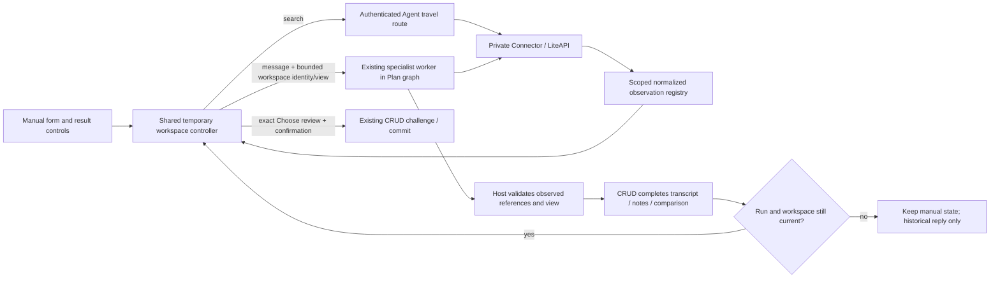

# Phase 18: Shared Flights and Stays Workspace Research

Researched 2026-10-27. Planning supplement to the original research and completed 18-01–18-05 history. No implementation, live provider call, test execution, deployment, or acceptance closure was performed for this supplement.

## User Constraints

The orchestrator supplied the latest approved correction: manual booking-style controls are primary; manual controls and the specialist operate one shared temporary search/results/filter state; the specialist may search, refine, sort and dismiss temporary results with Undo; manual changes win races. Compare two or three options in the main workspace, with discussion in side chat. Remove duplicated full result browsers in chat and the specialist “View all results” import step. Preserve explicit, exact, unbooked Choose for trip confirmation. Keep separate topic histories and bounded Claude SDK workers inside the existing Plan LangGraph. Show source and observation time. Airline logos are requested, subject to supported metadata and safe display. This instruction supersedes the earlier two-browser/import interaction. [VERIFIED: orchestrator task instruction, 2026-10-27]

Existing context explicitly says: “The user previously chose discussion without interactive prototypes; retain that choice.” It also says: “Initially permit one active agent turn per Plan.” Preserve both. The original context's other scope and authority decisions remain applicable; this supplement does not change them. [VERIFIED: .planning/phases/18-focused-flights-and-accommodation-agents/18-CONTEXT.md, opened this session]

This supplement was reconciled with the updated D18-01–D18-10 decisions and WORKSPACE-SPEC before delivery. In particular, preserve open details against their original evidence and restore only bounded criteria/UI references through tab recovery; actual inventory is reauthorized through the registry. [PROPOSED]

## Project Constraints (from AGENTS.md)

Apply the mandatory planning/testing skill before planning and delivery; preserve its visual evidence gate even without prototypes. Execute through the existing GSD workflow. Respect explicit confirmation for durable Plan changes; one destination and return flights; capability gating and truthful freshness; supplier handoff only through eligible saved options and verified hosts; CRUD exclusive durable ownership; token-derived ownership at public boundaries; no secrets, raw supplier payloads or internal reasoning in browser/log/checkpoint projections; idempotency and obsolete-event rejection; seven-day deletion/recovery/purge; independent frontend, Agent, CRUD and private Connector deployables. Reuse existing patterns; no new conventions were established by this research. [VERIFIED: AGENTS.md:3-28, 103-136]

The testing skill requires authenticated Chrome DevTools exercises, inspected screenshots and console/network checks for frontend delivery, plus real HTTP/database readback for changed CRUD behavior. Its explicit instruction is “If verification remains blocked, describe the work as incomplete or unverified”. This supplement supplies a validation plan, not that evidence. [VERIFIED: docs/skills/travella-testing/SKILL.md:24-59]

## Summary

Use one workspace controller mounted per Plan and topic. Move temporary form, applied query, full normalized result snapshot, filters, sort, dismissals and comparison references out of TravelSearch into that controller. Make TravelSearch controlled; keep TravelConversation focused on prose, compact reference links and progress. Reuse the manual HTTP search path, server observation registry, bounded specialist tools, CRUD completion and exact-choice challenge/commit. These are recommendations, not claims of shipped behavior. [PROPOSED]

The smallest safe agent integration is one validated workspace input and one atomic final workspace result after successful turn completion. Intermediate searches/refinements stay within the bounded worker; the UI automatically applies its final valid state without another import click. Give that applied batch one Undo. This avoids a second mutation protocol and per-tool browser acknowledgements while satisfying autonomous temporary research. Do not emit full inventory into durable topic snapshots or graph channels. [PROPOSED]

## Architectural Responsibility Map

| Capability | Primary owner | Secondary owner | Planned responsibility |
| --- | --- | --- | --- |
| Draft form, filters, sort, dismissal, comparison, Undo | Browser workspace controller | — | One reducer and precedence fence for both manual and agent changes. [PROPOSED] |
| Search, option identity, safe normalized facts | Agent host | Private Connector | Authorize Plan, resolve observations, validate options and response envelopes. [PROPOSED] |
| Bounded autonomous refinement | Existing specialist SDK worker | Existing Plan graph | Use same search contracts and view vocabulary as manual controls. [PROPOSED] |
| Transcript, attributed notes, historical comparison, preferred choice | CRUD | Agent signs observed evidence | Keep existing atomic complete and challenge/commit ownership. [PROPOSED] |
| Carrier metadata and image hygiene | Private Connector | Agent schema and browser image component | Normalize actual supplier metadata; retain names without images. [PROPOSED] |

## Standard Stack

Reuse existing dependencies; install none for this correction. The manifest declares `"react": "^19.1.0"`, `"zod": "3.25.76"`, `"vitest": "^4.1.11"`, and `"test": "vitest run"`. These are manifest constraints, not an assertion of current registry versions. [VERIFIED: frontend/package.json:5-30]

The backend manifest declares `"claude-agent-sdk==0.2.163"`, `"langgraph>=0.6,<1"`, `"fastapi>=0.115,<1"`, and `dev = ["pytest>=8,<10", "ruff>=0.11,<1"]`. Retain the lockfile. No package legitimacy audit or package upgrade is needed because this recommendation installs no packages. [VERIFIED: pyproject.toml:6-25]

## Existing Seams and Source Evidence

| Component | Current behavior | Planning consequence |
| --- | --- | --- |
| TravelSearch | Local state owns form, `snapshot`, `compared`, `budget`, `refundable`, `direct`, `bag`, `sort`. Search replaces snapshot and resets filters/comparison; it already aborts old requests and compares an epoch before accepting responses. [VERIFIED: frontend/src/features/plans/travel/TravelSearch.jsx:424-508, 586-629] | Extract state/transition logic, retain form controls, detail views, pagination, price formatting and result rendering. [PROPOSED] |
| TravelWorkspace | `browse(searchId)` fetches `research/snapshot` into a handoff; `renderSuggestions` inserts full research cards into each message; compare opens chat. [VERIFIED: frontend/src/features/plans/travel/TravelWorkspace.jsx:34-46, 75-109] | Remove specialist handoff and full chat cards; put active comparison, saved choice and shortlist in the main panel. Keep compact message links bound to references. Preserve legacy Trip imports at a compatibility boundary. [PROPOSED] |
| TravelConversation | Stores text draft separately and calls `chat.send(text, ...{ intent: 'discuss', options: ... })`; suggestion rendering is an injected callback. [VERIFIED: frontend/src/features/plans/travel/TravelConversation.jsx:6-17, 26-36] | Keep its transcript/composer structure; replace callback content rather than creating another chat. [PROPOSED] |
| useTravelConversation | `stop()` aborts locally, asks server cancellation, then polls until the snapshot is unlocked; failure retains the run and blocks further sends. Events are fenced by current run, cancellation and mount epoch. [VERIFIED: frontend/src/features/plans/travel/useTravelConversation.js:29-84] | Add workspace-revision checks alongside existing run checks; preserve lock acknowledgement and visible retry. [PROPOSED] |
| TravelRegistry | Safe observations are process-local and scoped by subject/Plan. `get(...topic)` checks topic/expiry; `resolve` verifies exact option/room. `manual` creates a ten-minute full normalized snapshot. [VERIFIED: services/agent/travel_registry.py:18-73] | Resolve workspace references server-side. Registry loss is an expired-reference condition, never permission to accept browser-supplied facts. [PROPOSED] |
| Manual travel routes | Ownership is read before dispatch; search result IDs are registered and truncated results reconciled against registry contents. [VERIFIED: services/agent/travel_routes.py:32-50, 79-87] | Return a canonical safe workspace snapshot from the same response, or fetch registry snapshot internally without user action. Align manual and agent normalization. [PROPOSED] |
| Specialist worker | `SpecialistAnswer` allows bounded answer, input-needed flag, up to three comparison references and six notes. The worker registers full observations, but its final result only exposes comparison/notes. [VERIFIED: services/agent/claude/travel_specialist.py:43-47, 249-282] | Add the narrow view-operation tool and final workspace selection to this worker; host authors resulting snapshot. [PROPOSED] |
| Request-local graph seam | `collect_travel_results` writes a ContextVar collector; the graph adds it to Canvas or flight-preview output only. The specialist subflow explicitly uses `checkpointer=False`. [VERIFIED: services/agent/request_context.py:21-42; services/agent/graph/builder.py:61-76, 114-122; services/agent/graph/nodes/travel_specialist.py:27-46] | Add a separate request-local workspace-result collector and attach it after graph invocation; never add inventory to the compiled parent state. [PROPOSED] |
| Specialist completion | Reserves one Plan run; resolves attached references; generation-checks result; signs observed comparison; shields CRUD completion; returns the saved topic snapshot only after commit. Manual exact review bypasses the model. [VERIFIED: services/agent/specialist_service.py:12-104] | Emit the ephemeral workspace result only after this successful completion boundary. Preserve deterministic manual Choose review. [PROPOSED] |
| CRUD | Input digest binds topic/message/generation/discussion; completion checks live lease and brief digest. Historical comparisons persist with reply identity; choice checks freshness, facts and exact confirmation. [VERIFIED: services/crud/topic_conversations.py:119-195, 203-283] | Bind the new workspace input digest into begin/complete too; no new durable inventory table or workspace service. [PROPOSED] |
| Tab recovery | Canvas uses `sessionStorage` with a bounded memory fallback and explicit clear/forget helpers; current Canvas callers key by Plan ID. [VERIFIED: frontend/src/features/plans/canvasViewState.js:1-24, 32-35; frontend/src/features/plans/components/PlanningCanvas.jsx:36-38] | Extend the convention with strict workspace parsing and owner/Plan/topic scope. Clear on logout/account switch; never persist full inventory or reuse the separate mock-checkout token keys. [PROPOSED] |

Existing topic and choice values, quoted verbatim: `Topic = Literal["trip", "stays", "flights"]`; `intent: Literal["discuss", "compare", "review"] = "discuss"`; `action: Literal["shortlist", "prefer", "remove"]`; `readiness: Literal["researching", "ready", "needs_review"] = "researching"`. Do not overload choice actions for temporary dismissals. [VERIFIED: services/travel_topics.py:11-12, 26-34, 101-118]

Existing result filtering excludes unknown values when an affirmative filter is requested; sort preserves provider order or derives price/duration/review ordering. Its source values are `sort === "price"` and `sort === "provider"`; the form's default is `useState("provider")`. Keep the initial vocabulary aligned with existing controls; add new criteria only with explicit schemas. [VERIFIED: frontend/src/features/plans/travel/TravelSearch.jsx:383-422, 457]

## Architecture Patterns



The diagram is a proposed data flow. [PROPOSED]

### Smallest concrete contract

All names in this subsection are proposed additions, not existing enum/schema claims. [PROPOSED]

1. **Input:** optional `workspace_context` on focused turns: `instance_id`, monotonic `revision`, nullable current `search_id`, strict `view`, and `draft_dirty`. View contains bounded local filters, sort, dismissed option IDs and up to three comparison references. A valid applied query may be included only as the typed existing flight/stay search contract when no observation yet exists; do not send incomplete strings, fabricated supplier results or arbitrary dictionaries. When an observation exists, its registry criteria are authoritative. Dirty draft controls remain browser-local and are not model instructions.
2. **Host validation:** validate topic, all field lengths/numbers, search ownership/expiry, selected IDs and exact room IDs. Resolve facts from the registry. Model sees a bounded projection of current applied view, observed result IDs and the saved trip brief. A browser revision is a concurrency token, never authorization or a Plan revision.
3. **Worker capability:** add one topic-restricted `update_workspace_view` tool with a strict patch schema for filters/sort/dismissed/comparison only. Search remains the existing bounded search tools. Both update the worker's private copy of workspace state. Return applied counts and explicit unknowns to the model; keep provider-call budgets unchanged. One bounded local action ceiling prevents unlimited view-tool loops.
4. **Final output:** optional `workspace_update` containing `action_id` derived by host from run identity, echoed Plan/topic/instance/base revision, final registry `search_id`, full safe normalized snapshot when search changed, strict final view and a short host-authored change summary. Model output contains only observed references and typed requested changes; it cannot fabricate the public envelope or write arbitrary result fields.
5. **Delivery:** collect outside graph checkpoint channels; release only after successful CRUD completion and generation check. Extend AgentResponse, stream terminal/state projection, auth/runtime path and frontend parser together. Repeated STATE_SNAPSHOT and TERMINAL delivery of the same `action_id` is idempotent. A transcript refresh never reapplies an action.
6. **Client application:** one reducer validates identity, expected revision, current run, expiry and result membership, then changes query/results/view atomically. Store a bounded pre-action inverse in memory for Undo; show a concise activity notice. Changing results resets page and obsolete dismissals/comparison unless the same referenced objects still exist. Preserve an open detail panel with its original search reference and freshness labels; never rebind a coincidentally matching ID to new evidence. Do not merge separate search result sets silently.

Use a batch at successful turn completion initially. Streaming intermediate temporary mutations would need acknowledgements, sequencing and partial rollback behavior; it is unnecessary for the approved shared-state outcome. If future UX explicitly needs each tool's live update, add that as a separate protocol change. [PROPOSED]

### Manual precedence and lifecycle

| Trigger | Required transition |
| --- | --- |
| User types into query form | Increment local revision immediately; mark draft dirty. Keep results labeled with their applied criteria. Invalidate any in-flight agent batch and initiate Stop if active. Do not run provider search per keystroke. [PROPOSED] |
| User changes local result filter/sort, comparison or dismissal | Apply immediately through the same reducer and increment revision. Revoke active agent batch authority; stop active turn. Local filters describe returned inventory, never imply supplier-wide coverage. [PROPOSED] |
| Manual Search while agent active | Capture and validate draft; increment revision and revoke old batch before any await. Abort older manual request. Start cancellation and manual read-only search independently; manual browsing/search remains usable even if cancellation acknowledgement is delayed. Keep subsequent specialist turns and durable choice blocked until existing lease is resolved. [PROPOSED] |
| Manual search succeeds/fails | Accept only current request identity/revision. Success atomically sets applied query, results and clean draft baseline; failure keeps previous labeled results and current draft. Agent cancellation failure never rolls back the user's edits. [PROPOSED] |
| Chat send while form has unsent edits | Permit discussion of current applied results with a visible pending-edits note, but prohibit agent workspace mutations until the user submits/discards that draft. Never silently overwrite it or treat it as persisted trip requirements. [PROPOSED] |
| Agent batch succeeds | Apply automatically only if instance/revision/run and all references still match. No import or accept click for temporary state. Draft fields may synchronize only when clean. [PROPOSED] |
| User presses Undo | Restore only the immediately preceding agent workspace batch if no later user/workspace mutation occurred. Increment revision, invalidate run authority and clear Undo. Keep original observation times/expiry; Undo is not a fresh search and cannot undo durable choice. [PROPOSED] |
| Stop, disconnect, topic switch, unmount | Revoke batch authority immediately; keep current stable workspace. Use existing acknowledged cancellation/lease handling. Late text, snapshots, fetch completion and duplicated terminal events cannot resurrect prior state. [PROPOSED] |
| Commit wins cancellation race | Refresh truthful committed transcript/notes, but do not apply the rejected workspace batch. Show that the earlier reply completed before stopping when useful. Existing shielded completion makes this race real. [PROPOSED; VERIFIED: services/agent/specialist_service.py:94-104] |
| Reload / another tab | Start a fresh workspace instance; restore allowlisted bounded criteria, filters, sort, dismissals/comparison and search references from tab-scoped recovery keyed by owner/Plan/topic, plus durable topic history/choice from CRUD. Resolve references through the authorized registry before presenting active inventory. Do not store provider payloads/checkout handles or replay historical workspace actions. Expiry/eviction/restart yields Search again with saved UI state and historical evidence labeled. Undo resets. Separate tabs remain independent; server lease and choice revisions retain durable arbitration. [PROPOSED] |
| Saved trip details change | Invalidate workspace applicability, action batch and open choice review; retain historical research with clear stale labels. Require fresh compatible evidence before confirming. [PROPOSED] |

Draft query state and applied local filters have different meanings: typing dates does not change the criteria of already displayed quotes; a local filter immediately changes which already-returned quotes are visible. Keep both meanings explicit in UX and worker input. [PROPOSED]

### Comparison and durable selection

Use the existing two-to-three reference validation for main comparison selection, including exact room references when a room is selected. Opening chat discusses that visible comparison without rebuilding cards there. Keep main comparison open when the response arrives. Property-level comparisons must not imply a particular room is chosen. [PROPOSED]

Manual Choose already resolves exact observed room/flight evidence without calling the model, then creates a historical comparison; the frontend prepares and commits a revision-bound challenge. Keep that flow, render the review in the main workspace, and preserve the unbooked label. Do not require a conversational turn as a semantic permission to choose. [VERIFIED: services/agent/specialist_service.py:59-66; frontend/src/features/plans/travel/TravelWorkspace.jsx:48-73, 112-123]

## Airline Identity and Logos

The private normalizer reads supplier `marketingName`, `marketingCode`, `operatingName`; it forms `flight_number` from marketing code/number and projects only name strings in `airlines`. The opened segment schema declares `airline`, `operating_airline`, `flight_number`, `duration_minutes`, `technical_stops`; it has no code or logo fields. This is a concrete current projection gap, not a claim that the supplier lacks logos. [VERIFIED: services/mcps/liteapi.py:296-322, 365-385; services/agent/travel_contracts.py:285-313; services/agent/claude/canvas_travel.py:83-110]

The official rates response example includes `marketingCode`, `marketingLogo`, `marketingName`, `operatingCode`, `operatingLogo`, `operatingName`. The official airline-directory reference explicitly describes name, IATA/ICAO and logo information; its example includes a relative logo path. Those pages display an update age of six months at inspection. [CITED: https://docs.liteapi.travel/reference/post_flights-rates] [CITED: https://docs.liteapi.travel/reference/get_data-flights-airlines]

**Recommendation:** extend normalized segment metadata with optional bounded marketing/operating code and logo fields, preserving existing carrier names. Propagate through the public Flight contract, safe FlightOption/FlightSegment projection and strict browser schema; otherwise one boundary silently strips or rejects the fields. Derive display carrier groups from actual segment data; show multiple carriers and preserve operating-carrier text for codeshares. Never infer carrier identity from a display name or parse flight-number text to manufacture a code. [PROPOSED]

Prefer the logo URL attached to the observed flight segment. Do not add airline-directory calls to the bounded agent catalog merely to decorate results. Do not construct logo URLs from codes, substitute a guessed airline, use offer-provider branding as airline branding, or introduce a new logo vendor. Accept only supplier-observed absolute HTTPS URLs passing a dedicated host/prefix policy; treat relative URLs as unavailable until an authoritative base is established. Keep fields nullable and render carrier text with a neutral icon when missing/invalid/blocked/load-failed. Use no-referrer images and fixed dimensions, not downloaded SVG injection. [PROPOSED]

Current image helpers reject credentials/query/hash and unsafe schemes, and the frontend image component already handles error fallback. They are useful patterns; add the carrier-specific host policy and tests as part of logo implementation. [VERIFIED: services/mcps/liteapi.py:71-95; frontend/src/features/plans/travel/CanvasTravel.jsx:9-21] [PROPOSED]

**Execution dependency:** display of the documented supplier-provided marketing/operating logo fields is planned and requires no additional user approval. No live response from this account was requested in this research, so execution must verify actual returned values and exact image hosts with a bounded provider sample and safe-image tests. Missing, unsafe or failed images use the text/neutral-icon fallback. No supplier restriction was established in this research; do not infer a permission gate from that uncertainty. This limitation requires no additional service and does not block the core workspace. [PROPOSED]

## Don't Hand-Roll / Common Pitfalls

- Reuse registry ownership and typed safe snapshots instead of trusting client/model result objects. Reuse the existing CRUD proof, revision and confirmation path for saved choices. [PROPOSED]
- Do not use generic JSON Patch, model-authored JavaScript, arbitrary URLs or a second agent-controlled state store. Use the same reducer and typed view operations. [PROPOSED]
- Do not use Plan revision as a temporary view revision: user sorting and form edits do not save the Plan. Do not rely only on AbortController: existing epoch tests demonstrate deferred completions can arrive after navigation. [PROPOSED; VERIFIED: frontend/src/features/plans/travel/TravelSearch.test.jsx:86-108]
- Update every public projection boundary together. Current AgentResponse declares `travel_specialist_result: TopicSnapshot | None = None`, the SSE terminal explicitly copies it, and plansApi has its own allowlisted state/terminal parser. Adding only a worker field will not deliver it. [VERIFIED: services/agent/http_contracts.py:53-75; services/agent/service.py:448-456, 494-502; frontend/src/plansApi.js:55-69]
- Do not conflate selected provider IDs and persisted evidence IDs. CRUD replaces each historical comparison's `id` with `str(uuid4())`, while `reference` retains live search/option/room identity. Use full references for temporary operations and evidence IDs only for saved-choice mutations. [VERIFIED: services/crud/topic_conversations.py:166-169; services/travel_topics.py:20-23, 38-48, 101-103]
- Registry retention is bounded (`limit=256`) and process-local. Expiry/restart/eviction requires re-search; do not promise restored live inventory across reload or multiple service instances. [VERIFIED: services/agent/travel_registry.py:18-44]

## Runtime State Inventory

This is a frontend state extraction and additive wire-contract change, not a service rename. [PROPOSED]

| Category | Observation | Required action |
| --- | --- | --- |
| Stored data | Topic history, comparison replies and choices live in CRUD; temporary full observations live in process memory. [VERIFIED: services/crud/topic_conversations.py:161-195, 263-283; services/agent/travel_registry.py:18-35] | Preserve rows, migration history and old reply readability. Optional workspace-input digest can reuse run payload hashing; do not persist full workspace inventory. [PROPOSED] |
| Live service config | No external service configuration was queried in this planning task. | No configuration rename required by proposed contract. Verify actual logo origins in the bounded execution sample. [PROPOSED] |
| OS registrations | Not inspected; no OS registration change is proposed. | None in planned scope. [PROPOSED] |
| Secrets/env names | No secret values read and no key rename proposed. | Reuse existing Connector credentials and comparison signing; avoid new secrets for branding. [PROPOSED] |
| Build artifacts | Frontend and service source will change in execution. | Rebuild local image using project startup skill, verify changed-source hashes; leave volumes and installed SDK sessions intact. [PROPOSED] |

## Environment Availability

Local probes returned Node `v24.21.0`, Python `3.14.7`, uv `0.12.17`, Docker CLI `29.8.1`. These prove command availability only; no service health, lockfile runtime, database or live provider availability was asserted. [VERIFIED: local version probes, 2026-10-27]

The research seam requested Context7 for provider documentation. Neither a Context7 tool nor ctx7 CLI was available, so official docs were checked via web search/open. `classify-confidence --provider websearch --verified` returned `MEDIUM`; official-source findings above use CITED provenance. Both digests were cached through the research-store seam. [VERIFIED: tool discovery and research seam outputs, 2026-10-27]

The existing local-start skill supplies the startup/auth workflow. Runtime execution must verify the app, credentials, Chrome DevTools and provider capability before claiming acceptance. This research did not start Docker or invoke the model. No new external package, deployed service or storage is proposed. [PROPOSED]

## Validation Architecture

Existing frontend command is `npm --prefix frontend test -- ...`; existing Python setup supports `uv run --locked pytest ...`. Default Python testpaths list only auth/CRUD, so explicitly name Agent/MCP directories in correction plans. [VERIFIED: frontend/package.json:5-10; pyproject.toml:25-32]

| Requirement scope | Verification to add/update | Existing seam |
| --- | --- | --- |
| FOCUS-05 shared controls | Manual search → agent filter/sort/dismiss → identical visible controls/results; Undo; main 2–3 comparison with side discussion; no full chat browser/import step. [PROPOSED] | TravelSearch.test.jsx, TravelConversation.test.jsx and plansApi.test.js were opened/located during this session. |
| FOCUS-06 manual precedence | Deferred agent completion after draft edit; manual filter after agent starts; manual search while cancellation fails; old search completion after new search; duplicate batch; wrong Plan/topic/instance; reload/history must not reapply; late commit must not replace manual state. [PROPOSED] | Existing late-result and cancellation fixtures: TravelSearch.test.jsx:86-108; TravelConversation.test.jsx cancellation cases. |
| FOCUS-03/04 bounded autonomy | Actual SDK registration/handler allows only the new typed view tool plus existing topic tools; forged result IDs, unsupported filters, arbitrary fields and exceeded budgets rejected; no choice or checkout authority. [PROPOSED] | test_specialist_worker.py, test_specialist_tools.py, test_travel_specialist_journey.py. |
| FOCUS-07 exact choice | Deterministic exact room review, challenge, confirm, readback/reload; no mutation from sort/dismiss/Undo; stale/replayed/wrong-owner challenge fails. [PROPOSED] | test_travel_specialist_journey.py:120-147; test_topic_conversations.py:170-233, 292-319. |
| FOCUS-08 carrier/freshness | Provider/name/time always visible; missing code/logo, multiple carriers, different operator, unsafe/relative image URL and image load failure; no fabricated mapping; inspection does not silently refresh search age. [PROPOSED] | MCP normalization + strict server/browser schema + UI tests. |
| FOCUS-01/02/09/10 regressions | Topic histories and notes remain isolated; no raw provider data/checkpoints; brief digest/readiness behavior unchanged; lifecycle and ownership HTTP suites. [PROPOSED] | Existing CRUD topic tests and specialist journey fixtures. |

Proposed focused commands (not executed here):

```sh
npm --prefix frontend test -- src/features/plans/travel/TravelSearch.test.jsx src/features/plans/travel/TravelConversation.test.jsx src/plansApi.test.js
uv run --locked pytest services/agent/tests/test_travel_registry.py services/agent/tests/test_travel_specialist_journey.py services/agent/tests/test_specialist_worker.py services/agent/tests/test_specialist_tools.py
uv run --locked pytest services/mcps/tests/test_liteapi.py services/mcps/tests/test_travel_research.py services/auth/tests/test_travel_proxy.py services/crud/tests/test_topic_conversations.py
npm --prefix frontend run build
```

Split per-task selectors to fit a short feedback cycle; measure actual run time rather than promise every combined command is under thirty seconds. Add reducer/contract tests in the first implementation wave. Run real FastAPI/database tests for changed begin/complete fields and choice behavior; mocks alone are insufficient. [PROPOSED]

Browser gate: authenticated example account, desktop and mobile, manual search followed by natural-language refinement, live visible filter/sort/dismiss/Undo, compare and exact choose, refresh and topic switch, dirty-form and cancellation races, expired/empty/error/provider-disabled states, console/network inspection and screenshots. Run bounded live SDK/provider quality cases separately; fixtures cannot close earlier live-quality or UAT gaps. The correction plans must preserve earlier 18-01–18-05 summaries and open acceptance records. [PROPOSED]

## Security Domain

Use version-qualified ASVS references. The official ASVS 5 index uses V2 Validation/Business Logic, V3 Web Frontend, V4 API, V6 Authentication, V7 Session Management, V8 Authorization, V9 Tokens, V10 OAuth/OIDC, V11 Cryptography, V15 Safe Concurrency and V16 Logging/Error Handling. Do not copy legacy V2-auth/V4-access labels as ASVS 5. [CITED: https://cheatsheetseries.owasp.org/IndexASVS.html]

For this correction enforce schema validation, token-derived registry ownership, fresh exact-choice proofs, bounded tools and data, revision fencing, safe image origins, no-referrer loading and redacted telemetry. Threat cases are cross-Plan option injection, obsolete-state replay, provider-text instruction injection, external image tracking, raw payload leakage and confusing temporary dismissal with durable deletion. Use existing cryptography; invent no new signature format for browser-only view changes. [PROPOSED]

## Assumptions and Open Questions

| Item | Disposition |
| --- | --- |
| Actual carrier/logo metadata returned by this account | No live sample was run. Implement documented supplier logo display and verify returned metadata/image hosts during bounded execution testing; preserve text fallback for missing or unsafe values. No extra permission checkpoint. [PROPOSED] |
| Temporary workspace recovery | The current WORKSPACE-SPEC requires bounded tab recovery. Reuse Canvas recovery conventions, store only allowlisted criteria/UI references, and reauthorize registry resolution after reload; no new database or cross-tab synchronization. [PROPOSED] |
| Need for intermediate per-tool UI updates | Not required by supplied correction. Recommend one automatically applied final batch with Undo; retain streamed explanation. [PROPOSED] |

## Sources and Confidence

Code paths above were opened with numbered shell reads because this runtime exposes no filesystem Read/Write tool; file creation used the available apply_patch API. Source definitions are quoted beside discrete-value claims. Existing behavior is source-grounded; proposed contracts are explicitly proposals and require tests during execution. [VERIFIED: tool inventory and commands in this research session]

Official provider sources: [flight rates](https://docs.liteapi.travel/reference/post_flights-rates), [airline directory](https://docs.liteapi.travel/reference/get_data-flights-airlines). Security mapping: [OWASP ASVS index](https://cheatsheetseries.owasp.org/IndexASVS.html). Documentation confidence is MEDIUM from the required seam. Live account responses and implemented application behavior remain to be tested during execution. [CITED: https://docs.liteapi.travel/reference/post_flights-rates] [CITED: https://cheatsheetseries.owasp.org/IndexASVS.html]
